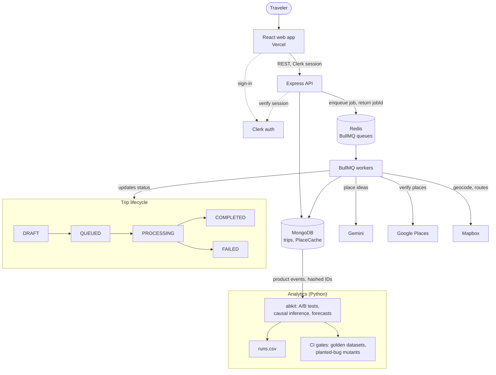
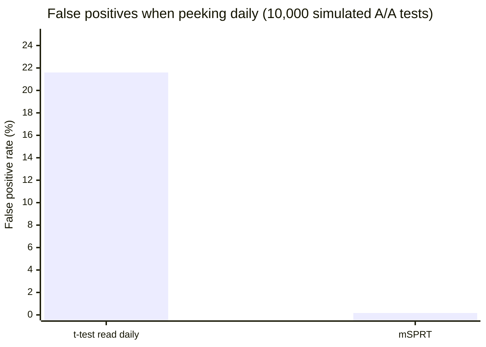
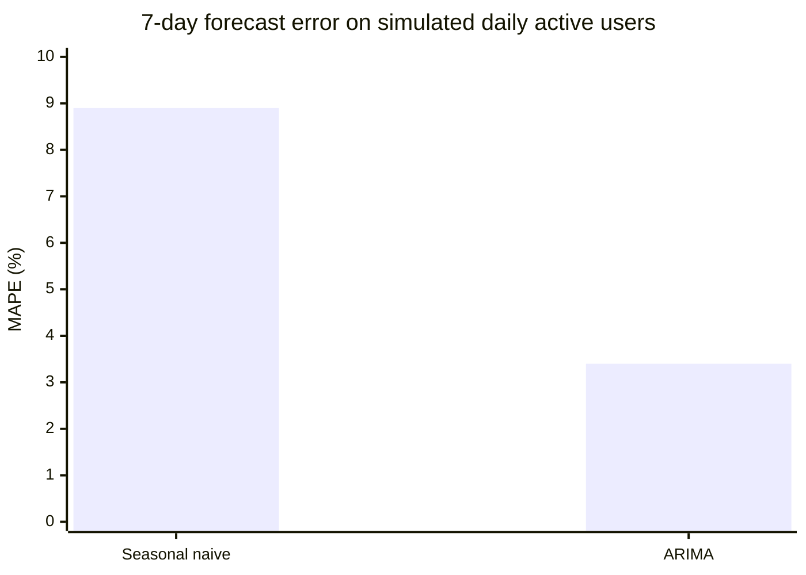
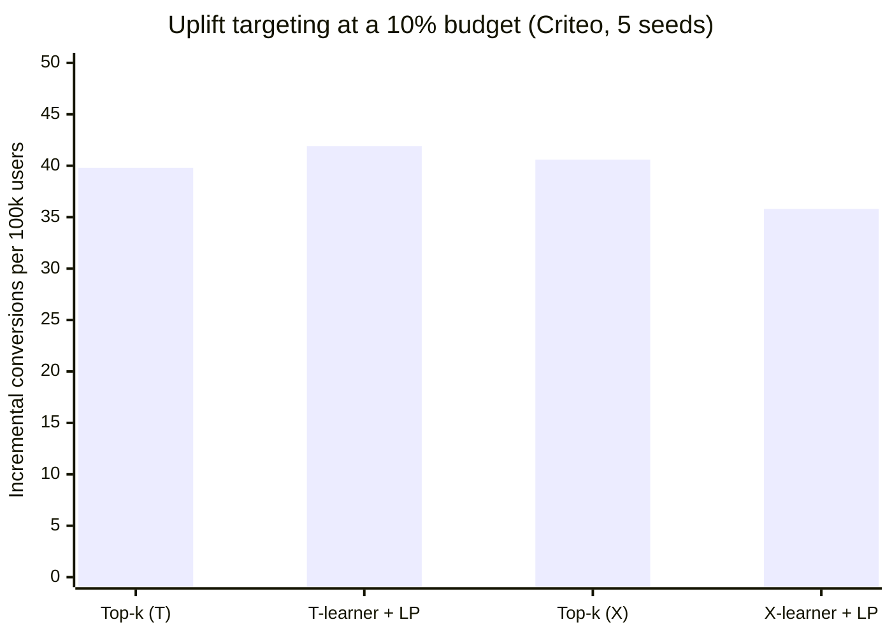

# TravelPlan

An AI travel planner that turns a destination and a few preferences into a day-by-day itinerary of real, verified places, plus `abkit`, the A/B testing and causal-inference toolkit used to measure it.

[](https://github.com/tlamDson/TravelPlan/actions/workflows/ci-main.yml)
[](#license)

**Live demo:** [plancare-web-omega.vercel.app](https://plancare-web-omega.vercel.app)



## What it does

- **Plans a trip from a short wizard:** pick a destination, dates, budget and interests; the itinerary is generated in the background while the page shows live progress.
- **Only suggests places that exist:** every place the AI proposes is checked against Google Places and Mapbox, then grouped by neighborhood so each day stays walkable.
- **Lets you work with the result:** view each day on a map, reorder stops, and regenerate any single stop you do not like.

## Results in numbers

Every number in this table and in the charts below is a row of [`analytics/runs/runs.csv`](analytics/runs/runs.csv) (a test checks them). Simulated users are labelled as simulated and are never counted as real users.

| Result                                                             | Number                                                             | Source (`runs.csv`)                                                   |
| ------------------------------------------------------------------ | ------------------------------------------------------------------ | --------------------------------------------------------------------- |
| False positives when peeking daily, 10,000 simulated A/A tests     | mSPRT **0.17%** vs daily t-test **21.6%**                          | `fpr_msprt_daily_peek`, `fpr_ttest_daily_peek`                        |
| Treatment-effect bias, 100 biased resamples of the Hillstrom RCT   | naive **3.7 pp** → doubly robust (AIPW) **-0.015 pp**              | `hillstrom_ate_bias_naive_diff`, `hillstrom_ate_bias_aipw`            |
| Planted bugs blocked by the golden-dataset CI gate                 | **10 of 10** mutants                                               | `golden_gate_mutants_blocked`                                         |
| GitHub Actions adoption vs PR merge time, staggered DiD, 292 repos | **-17.6%**, 95% CI -0.69 to 0.30 log1p hours: no detectable effect | `did_att_pct_main`, `did_att_ci95_low_main`, `did_att_ci95_high_main` |
| Budgeted uplift targeting, 10% Criteo sample (418,831 test users)  | T-learner + LP **+5.3%** conversions vs top-k; X-learner -12.0%    | `m8_lp_gain_over_topk_t_b10`, `m8_lp_gain_over_topk_x_b10`            |
| 7-day forecast of simulated daily active users (MAPE)              | seasonal-naive **8.9%** vs ARIMA **3.4%**                          | `forecast_mape_dau_seasonal_naive`, `forecast_mape_dau_arima`         |







## What I built

Solo project: product, backend, frontend, analytics and CI.

- **Queue-based trip generation:** `POST /api/trips` validates, enqueues a BullMQ job and returns a `jobId` at once; a worker runs the pipeline step by step, reports progress and saves partial results, and every step checks the trip's state so retries are idempotent.
- **AI treated as an untrusted service:** Gemini only proposes place ideas; each one is verified through Google Places with field-masked requests (only the fields used are billed), cached in a MongoDB `PlaceCache`, and wrapped in a circuit breaker.
- **Shared Zod contracts:** `packages/shared` holds the schemas, types and error codes used by both the API and the web app, so a contract change breaks the build instead of production.
- **`abkit`:** a Python A/B testing and causal-inference toolkit (deterministic assignment, Welch and delta-method tests, CUPED, mSPRT, AIPW, staggered DiD, uplift modelling, forecasting), with every measurement appended to `runs.csv`.
- **CI gates:** required lint, unit-test, typecheck/build and Docker checks on every PR, plus an `abkit` golden-dataset gate in CI that must block every planted-bug mutant.

## Tech stack

| Area      | Stack                                                                   |
| --------- | ----------------------------------------------------------------------- |
| Web       | React 19, Vite, TanStack Query, Zustand, Tailwind, shadcn/ui, Mapbox GL |
| API       | Node 20, Express 5, Mongoose, Zod, Pino, Clerk                          |
| Jobs      | BullMQ on Redis                                                         |
| AI & maps | Gemini, Google Places, Mapbox                                           |
| Data      | MongoDB Atlas                                                           |
| Analytics | Python: `abkit`, `simkit`                                               |
| Deploy    | Vercel (web), Railway (API, worker, Redis), GitHub Actions              |

## Quick start

Needs Node 20+, Docker, and API keys in `backend/.env` (see [`.env.example`](.env.example)).

```bash
git clone https://github.com/tlamDson/TravelPlan.git && cd TravelPlan && npm install
docker compose up -d mongodb redis
npm run dev:api   # then npm run dev:web and npm run dev:worker in two more terminals
```

Environment variables, Redis/TLS, deployment, scripts and troubleshooting: [DEVELOPMENT.md](DEVELOPMENT.md).

## License

MIT.
